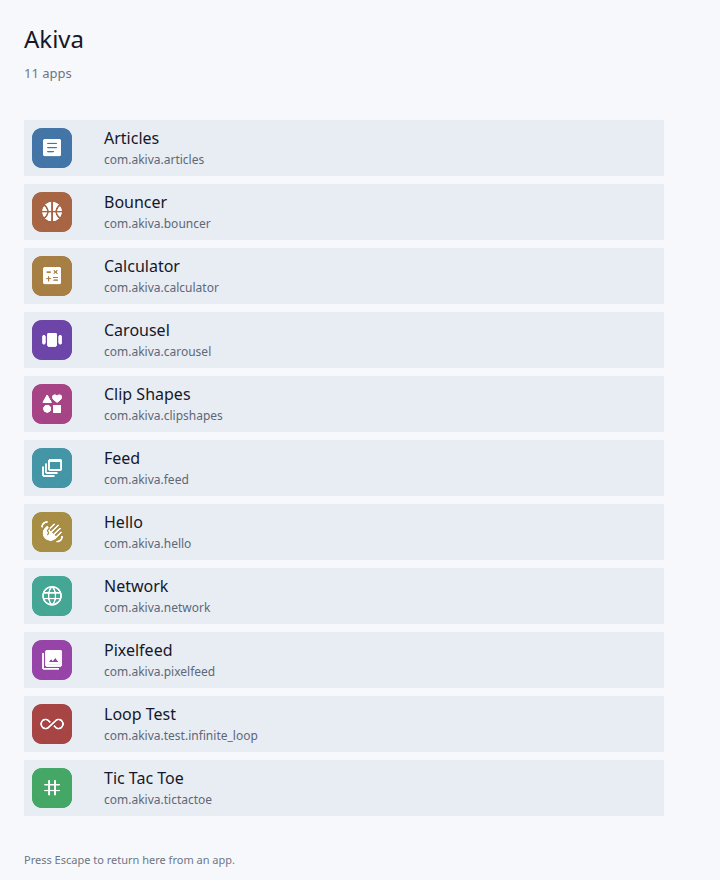

# Akiva Platform

**מערכת הפעלה אפליקטיבית** שרצה על הדפדפן כ-runtime. אפליקציות נכתבות בשפות native (Rust כרגע, עתיד: כל שפה שמתקמפלת ל-WebAssembly) ורצות בתוך OS מלא — עם Activity lifecycle, Resource system, Intent-based IPC, Package Manager ו-Window Manager.

> **לא web framework. לא מחולל אתרים. לא Flutter.** זו מערכת הפעלה שלמה שלוקחת את הדפדפן כ-kernel (כמו שאנדרואיד לוקחת את Linux kernel) ובונה מעליו אקוסיסטם אפליקציות native.

[English](README.md)

| מסך הבית | מחשבון | Bouncer (פיזיקת קפיצים) |
|---|---|---|
|  |  |  |

צילומי מסך אמיתיים מ-`akiva run`, עם Canvas2D, ב-Chrome headless.

## למה זה מעניין

- **המודל של אנדרואיד, בנוי מחדש על הווב.** Activities עם lifecycle אמיתי ו-task stack, מצב שמור ששורד רענון, resources עם qualifiers (`-night` היום, `-he` ו-`-land` מתוכננים), ו-Intents שמנתבים בין אפליקציות.
- **בידוד תהליכים אמיתי בתוך טאב.** כל אפליקציה רצה ב-Dedicated Worker משלה עם watchdog. `panic!` או `loop {}` אינסופי מפילים רק את האפליקציה שגרמה להם.
- **אפליקציות לא נוגעות ב-DOM.** אפליקציה שולחת paint ops דרך ABI עם גרסה, וה-kernel מרכיב ומצייר אותם ב-Canvas2D או ב-WebGPU.
- **מערכת אחת למשתמש, לא לטאב.** טאבים הם מסכים. leader נבחר עם Web Locks. כשהוא נסגר, טאב אחר מעלה kernel חדש, והאפליקציות מקבלות בחזרה מ-OPFS את המצב השמור שלהן.
- **toolchain אמיתי.** CLI בשם `akiva` שיוצר, בונה, אורז ומגיש אפליקציות, ו-SDK ב-Rust עם `Activity` אסינכרוני, שפת layout דקלרטיבית (AKML) ו-builder בשם `Ui`.

## הרצה מהירה

```bash
git clone https://github.com/akiva1132/akiva-platform
cd akiva-platform
cargo run --release -p akiva -- run     # בונה את ה-kernel ואת כל האפליקציות ומגיש
# פותחים http://127.0.0.1:4173
```

ה-toolchain המוצמד ב-`rust-toolchain.toml` מותקן לבד דרך `rustup`, כולל `wasm32-unknown-unknown`.

---

## מסמכי תכנון

### נקודות התחלה
- [vision.md](vision.md) — **החזון ברמה המושגית** (גרסה 0.2)
- [ARCHITECTURE.md](ARCHITECTURE.md) — **ארכיטקטורה טכנית** של כל המערכת
- [ROADMAP.md](ROADMAP.md) — **תוכנית פיתוח** שלב-אחר-שלב (כולל v0.1 MVP ו-v0.2)
- [docs/v0.2-design.md](docs/v0.2-design.md) — **תכנון v0.2**: מעבר מ-POC לשלד OS אמיתי

### מפרטי תתי-המערכות (עמוק)
- [docs/activity-model.md](docs/activity-model.md) — מודל Activity, lifecycle, task stack, launch modes, state layering
- [docs/akml.md](docs/akml.md) — שפת ה-layout הדקלרטיבית (AKML)
- [docs/resources.md](docs/resources.md) — מערכת resources עם qualifiers (`-he`, `-night`, `-land`)
- [docs/intents.md](docs/intents.md) — Intent system + PackageManager + PendingIntent + Broadcasts (post-MVP)
- [docs/window-manager.md](docs/window-manager.md) — WindowManager + Shell
- [docs/manifest.md](docs/manifest.md) — פורמט ה-`manifest.toml`
- [docs/abi.md](docs/abi.md) — חוזה ה-ABI (WIT / Component Model)
- [docs/sdk-rust.md](docs/sdk-rust.md) — SDK לפיתוח אפליקציות ב-Rust
- [docs/runtime-web.md](docs/runtime-web.md) — JS HAL: leader election, transport, event pipeline
- [docs/storage.md](docs/storage.md) — OPFS-backed KV store
- [docs/notifications.md](docs/notifications.md) — Notifications (MVP-thin)
- [docs/testing.md](docs/testing.md) — אסטרטגיית בדיקות
- [docs/observability.md](docs/observability.md) — Logging, tracing, debugging

---

## מבנה הפרויקט ומצב נוכחי

המבנה העדכני של התיקיות והסטטוס (Phase 14 סגור) מתוחזקים באנגלית: [Project layout](README.md#project-layout) ו-[Status](README.md#status). התוכנית המלאה שלב אחר שלב ב-[ROADMAP.he.md](ROADMAP.he.md).

---

## עקרונות יסוד

1. **OS אמיתית, לא סימולציה.** כל תת-מערכת קיימת, גם אם רזה. אין shortcuts שידרשו שכתוב אחר כך.
2. **אפליקציות native, לא JS.** Rust → wasm. אפשר להרחיב לשפות אחרות מאוחר יותר דרך אותו ABI.
3. **Single OS instance לכל משתמש.** מספר tabs = מספר displays, לא מספר מערכות. (ראה [ARCHITECTURE.md §9](ARCHITECTURE.md#9-single-instance-architecture-tabs--displays-not-devices))
4. **בלי DOM.** רנדור ישיר על canvas עם layout engine אמיתי. מערכת resources, מערכת styles.
5. **AOSP-inspired.** לוקחים את המושגים שהוכחו 20 שנה באנדרואיד ומיישמים אותם מחדש ב-Rust/wasm.

---

## רישיון

[MIT](LICENSE)

אייקוני האפליקציות ב-`apps/*/res/drawable/icon.png` מבוססים על
[Material Symbols](https://fonts.google.com/icons) (רישיון Apache 2.0).
