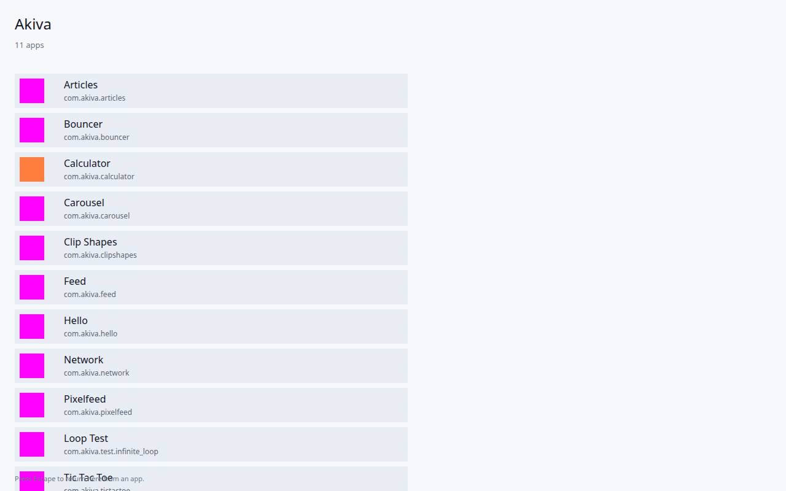
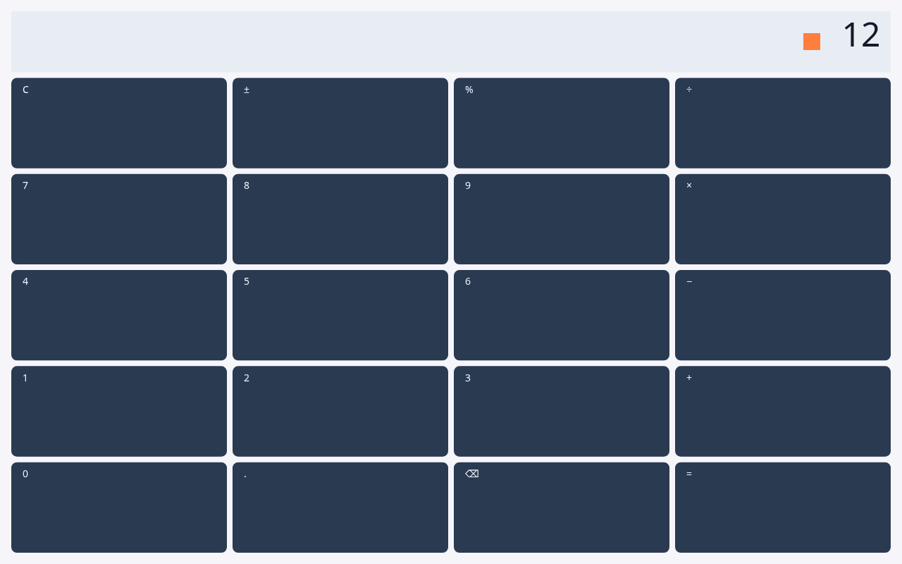
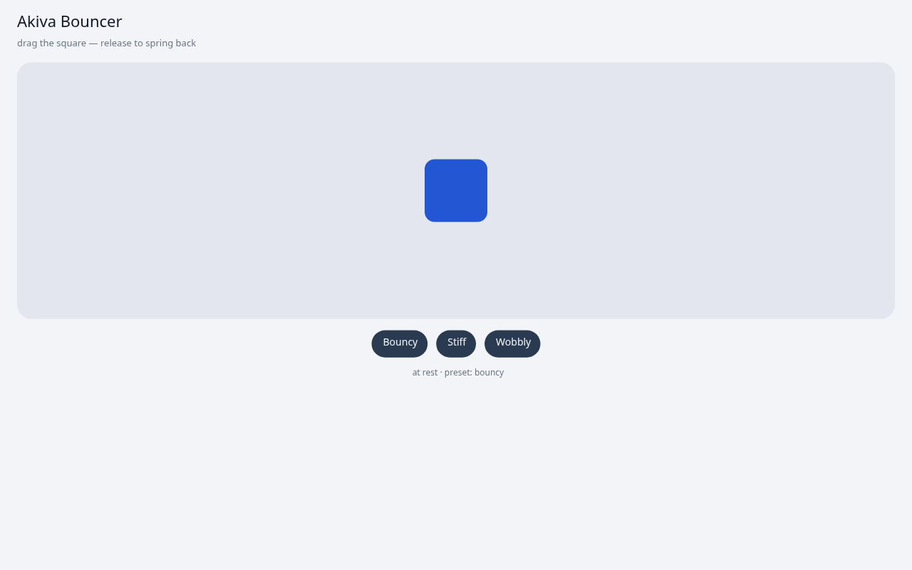

# Akiva Platform

**מערכת הפעלה אפליקטיבית** שרצה על הדפדפן כ-runtime. אפליקציות נכתבות בשפות native (Rust כרגע, עתיד: כל שפה שמתקמפלת ל-WebAssembly) ורצות בתוך OS מלא — עם Activity lifecycle, Resource system, Intent-based IPC, Package Manager ו-Window Manager.

> **לא web framework. לא מחולל אתרים. לא Flutter.** זו מערכת הפעלה שלמה שלוקחת את הדפדפן כ-kernel (כמו שאנדרואיד לוקחת את Linux kernel) ובונה מעליו אקוסיסטם אפליקציות native.

[English](README.md)



| מחשבון | Bouncer (פיזיקת קפיצים) |
|---|---|
|  |  |

צילומי מסך אמיתיים מ-`akiva run`, עם Canvas2D, ב-Chrome headless.

## למה זה מעניין

- **המודל של אנדרואיד, בנוי מחדש על הווב.** Activities עם lifecycle אמיתי ו-task stack, מצב שמור ששורד רענון, resources עם qualifiers (`-night`, `-he`, `-land`), ו-Intents שמנתבים בין אפליקציות.
- **בידוד תהליכים אמיתי בתוך טאב.** כל אפליקציה רצה ב-Dedicated Worker משלה עם watchdog. `panic!` או `loop {}` אינסופי מפילים רק את האפליקציה שגרמה להם.
- **אפליקציות לא נוגעות ב-DOM.** אפליקציה שולחת paint ops דרך ABI עם גרסה, וה-kernel מרכיב ומצייר אותם ב-Canvas2D או ב-WebGPU.
- **מערכת אחת למשתמש, לא לטאב.** טאבים הם מסכים. leader נבחר עם Web Locks, וכשהוא נסגר טאב אחר ממשיך את המערכת שרצה.
- **toolchain אמיתי.** CLI בשם `akiva` שיוצר, בונה, אורז ומגיש אפליקציות, ו-SDK ב-Rust עם `Activity` אסינכרוני, שפת layout דקלרטיבית (AKML) ו-builder בשם `Ui`.

## הרצה מהירה

```bash
git clone https://github.com/akiva1132/akiva-platform
cd akiva-platform
cargo run --release -p akiva -- run     # בונה את ה-kernel ואת כל האפליקציות ומגיש
# פותחים http://127.0.0.1:4173
```

ה-toolchain המוצמד ב-`rust-toolchain.toml` מותקן לבד דרך `rustup`, כולל `wasm32-unknown-unknown`.

---

## מסמכי תכנון

### נקודות התחלה
- [vision.md](vision.md) — **החזון ברמה המושגית** (גרסה 0.2)
- [ARCHITECTURE.md](ARCHITECTURE.md) — **ארכיטקטורה טכנית** של כל המערכת
- [ROADMAP.md](ROADMAP.md) — **תוכנית פיתוח** שלב-אחר-שלב (כולל v0.1 MVP ו-v0.2)
- [docs/v0.2-design.md](docs/v0.2-design.md) — **תכנון v0.2**: מעבר מ-POC לשלד OS אמיתי

### מפרטי תתי-המערכות (עמוק)
- [docs/activity-model.md](docs/activity-model.md) — מודל Activity, lifecycle, task stack, launch modes, state layering
- [docs/akml.md](docs/akml.md) — שפת ה-layout הדקלרטיבית (AKML)
- [docs/resources.md](docs/resources.md) — מערכת resources עם qualifiers (`-he`, `-night`, `-land`)
- [docs/intents.md](docs/intents.md) — Intent system + PackageManager + PendingIntent + Broadcasts (post-MVP)
- [docs/window-manager.md](docs/window-manager.md) — WindowManager + Shell
- [docs/manifest.md](docs/manifest.md) — פורמט ה-`manifest.toml`
- [docs/abi.md](docs/abi.md) — חוזה ה-ABI (WIT / Component Model)
- [docs/sdk-rust.md](docs/sdk-rust.md) — SDK לפיתוח אפליקציות ב-Rust
- [docs/runtime-web.md](docs/runtime-web.md) — JS HAL: leader election, transport, event pipeline
- [docs/storage.md](docs/storage.md) — OPFS-backed KV store
- [docs/notifications.md](docs/notifications.md) — Notifications (MVP-thin)
- [docs/testing.md](docs/testing.md) — אסטרטגיית בדיקות
- [docs/observability.md](docs/observability.md) — Logging, tracing, debugging

---

## מבנה הפרויקט (מתוכנן)

```
akiva-platform/
├── runtime/
│   ├── web/                  # JS HAL (Tab + Worker)
│   │   ├── index.html
│   │   ├── tab.js            # Tab HAL: canvas + input
│   │   └── worker.js         # Shared Worker HAL
│   ├── kernel/               # Kernel (Rust → wasm)
│   │   └── src/
│   │       ├── memory.rs
│   │       ├── scheduler.rs
│   │       ├── event_queue.rs
│   │       ├── storage.rs
│   │       ├── wasm_loader.rs
│   │       └── display_manager.rs
│   └── framework/            # Framework layer (Rust → wasm)
│       └── src/
│           ├── activity_manager/
│           ├── package_manager/
│           ├── resource_manager/
│           ├── window_manager/
│           ├── permissions/
│           ├── intent/
│           ├── akml/         # parser + inflater
│           ├── widgets/
│           ├── layout/
│           └── compositor/
│
├── sdk-rust/                 # Rust SDK לאפליקציות
│   └── src/
│       ├── lib.rs            # akiva_app!() macro
│       ├── activity.rs       # async Activity trait + Context
│       ├── canvas.rs         # immediate-mode Canvas
│       ├── executor.rs       # mini-executor (post-Stone 11.6.5)
│       ├── runtime.rs        # ABI v0.2 dispatch slot
│       ├── ui/               # Ui builder + layout + paint
│       ├── akml/             # parser + inflater + Bindings
│       ├── storage.rs        # async read/write handles
│       ├── intent.rs
│       ├── res.rs
│       ├── log.rs
│       └── op_kinds.rs       # cmd/io/status mirrors of wire crate
│
├── apps/
│   ├── shell/                # מסך הבית
│   ├── hello/                # אפליקציית בדיקה
│   └── calculator/           # אפליקציית הדגל הראשונה
│
├── cli/                      # akiva CLI
│   └── src/
│       └── main.rs
│
└── docs/                     # מסמכי עיצוב (ראה למעלה)
```

---

## מצב נוכחי

**Phase 11 (Process / Fault Isolation + Modern Async SDK) הושלם (May 2026).** ה-platform עברה מ-POC ל-OS אמיתי עם isolation מלא, async executor, ו-resource governance ראשוני. Phase 12 בעבודה. ראה [ROADMAP.md](ROADMAP.md) לפירוט.

**מה עובד היום:**

- ✅ **Process isolation** — worker-per-app (Stone 11.4c), watchdog enforcement, fault containment (`panic!`/`loop {}` בודד את ה-app בלבד)
- ✅ **Async SDK** — `Activity` trait async, mini-executor אמיתי (post-Stone 11.6.5), `TaskScope` עם cancellation, `Slot.pending` HashMap למקבילות per activity
- ✅ **Storage hybrid** — direct readonly `SyncAccessHandle` cache (~0.1ms cache hit) + kernel-routed writes; `WriteHandle` למסירת durability ack
- ✅ Kernel wasm ב-Dedicated Worker עם leader election + multi-tab failover
- ✅ Framework: Activity lifecycle state machine מלא, PackageManager (install/uninstall/rehydrate), IntentRouter, ResourceManager (strings + colors + night overlay)
- ✅ SavedState: TLV codec עם cross-worker async persistence pipeline (P0 #1 fix)
- ✅ Rendering: AKML (declarative) + `Ui` builder (imperative) + Canvas2D backend
- ✅ Widget toolkit: VStack/HStack/Text/Button/round-rect + `@color/`/`@string/` resource refs
- ✅ CLI: `akiva new/build/run/devserver/docs` + 3 templates (`default`, `compose-style`, `game`)
- ✅ **Resource governance partial** — per-app memory accounting (12.1), CPU attribution (12.2), Low-Memory Killer policy (12.3)
- ✅ אפליקציות אמיתיות: shell, calculator, tic-tac-toe

**מה לא עובד עדיין (Phase 12 ואילך):**

- ❌ App suspension (12.4) ו-manifest enforcement של `max_memory_mb` (12.5)
- ❌ פורמט הפצה אמיתי — `DEV_APPS` hardcoded; `akiva package`/`install` עוד stubs
- ❌ WindowManager: Phase 13 (overlays, dialogs, transitions, multi-display)
- ❌ Capabilities (Phase 14): WebSocket, Notifications, Clipboard, Vibration, Geolocation

**דחוי ל-Phase 13+:** Stream primitive (§19.7 ב-[docs/sdk-rust.md](docs/sdk-rust.md)), עברית/RTL, mobile baseline (Pixel 7 / iPhone 14).

ראה [ROADMAP.md](ROADMAP.md) לפירוט מלא של פאזות וסטטוס.

---

## עקרונות יסוד

1. **OS אמיתית, לא סימולציה.** כל תת-מערכת קיימת, גם אם רזה. אין shortcuts שידרשו שכתוב אחר כך.
2. **אפליקציות native, לא JS.** Rust → wasm. אפשר להרחיב לשפות אחרות מאוחר יותר דרך אותו ABI.
3. **Single OS instance לכל משתמש.** מספר tabs = מספר displays, לא מספר מערכות. (ראה [ARCHITECTURE.md §9](ARCHITECTURE.md#9-single-instance-architecture-tabs--displays-not-devices))
4. **בלי DOM.** רנדור ישיר על canvas עם layout engine אמיתי. מערכת resources, מערכת styles.
5. **AOSP-inspired.** לוקחים את המושגים שהוכחו 20 שנה באנדרואיד ומיישמים אותם מחדש ב-Rust/wasm.

---

## רישיון

[MIT](LICENSE)
