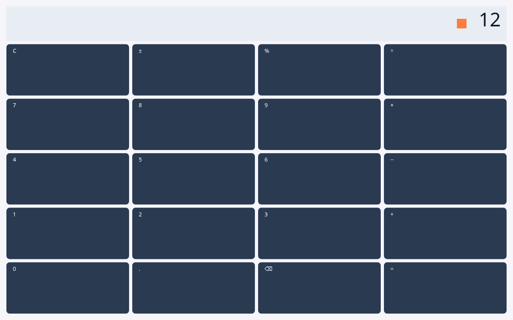
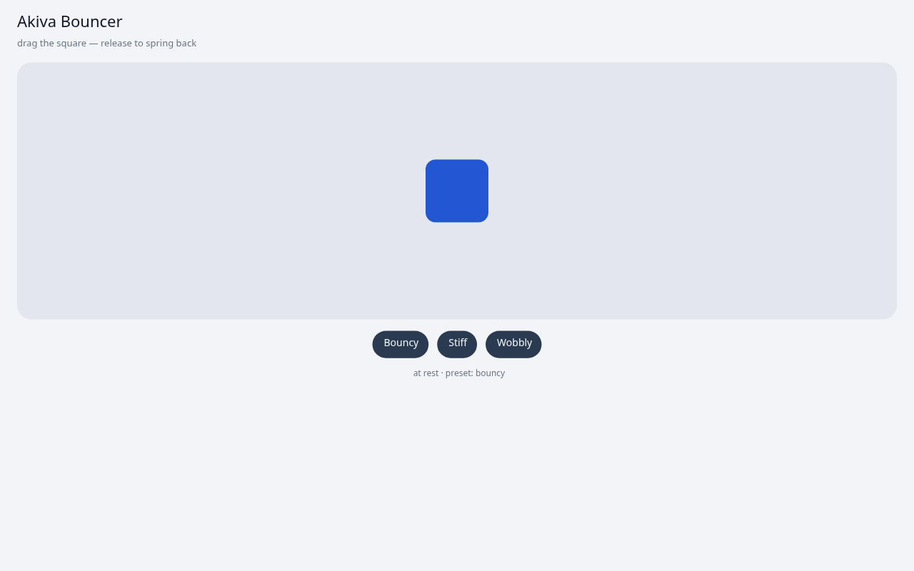

# Akiva Platform

**An applicative operating system that uses the browser as its kernel.**
Apps are written in Rust, compiled to WebAssembly, and run inside a
complete OS: Activity lifecycle, resources with qualifiers, Intent-based
IPC, a Package Manager and a Window Manager. No DOM, no JavaScript
framework: every pixel is laid out and painted by the platform itself.

[עברית](README.he.md)

| Calculator | Bouncer (spring physics) |
|---|---|
|  |  |

Real screenshots from `akiva run`, Canvas2D backend, headless Chrome.

---

## Why it is interesting

- **The Android model, rebuilt on the web.** Activities with a real
  lifecycle state machine and task stack, launch modes, saved state
  that survives a reload, resources with qualifiers (`-night` today,
  `-he` and `-land` planned), and Intents that route between apps. The browser plays
  the role the Linux kernel plays for Android.
- **True process isolation in a tab.** Each app runs in its own
  Dedicated Worker with a watchdog. A `panic!` or an infinite `loop {}`
  takes down only the offending app; the shell and the other apps keep
  running.
- **Apps never touch the DOM.** An app emits paint ops over a versioned
  ABI; the kernel composites them and draws through a Canvas2D or WebGPU
  backend. The same app could run on a native shell later without a
  rewrite.
- **One OS per user, not per tab.** Tabs are displays. A leader is
  elected with Web Locks; if the leader tab closes, another tab boots a
  fresh kernel, and apps get their saved state back from OPFS.
- **Capabilities behind permissions.** WebSocket, WebTransport,
  notifications, clipboard, vibration and geolocation are exposed to
  apps only when declared in the manifest.
- **A real toolchain.** An `akiva` CLI scaffolds, builds, packages and
  serves apps; there is a Rust SDK with an async `Activity` trait, a
  declarative layout language (AKML) and an immediate-mode `Ui` builder.

## Architecture at a glance

```
 ┌───────────────────────────── browser tab ─────────────────────────────┐
 │  tab.js: canvas, input, leader election (Web Locks + BroadcastChannel) │
 └───────────────────────────────────┬───────────────────────────────────┘
                                     │ input events + OffscreenCanvas (transferred)
 ┌───────────────────────────────────▼───────────────────────────────────┐
 │  kernel.wasm (Dedicated Worker)                                        │
 │    framework: ActivityManager · PackageManager · IntentRouter          │
 │               WindowManager · ResourceManager · Permissions · LMK      │
 │    compositor → DrawHal (Canvas2D / WebGPU)        storage → OPFS      │
 └──────────┬──────────────────────┬──────────────────────┬──────────────┘
            │ ABI (paint ops only) │                      │
 ┌──────────▼─────────┐ ┌──────────▼─────────┐ ┌──────────▼─────────┐
 │ app.wasm (worker)  │ │ app.wasm (worker)  │ │ app.wasm (worker)  │
 │ shell              │ │ calculator         │ │ ...                │
 │ Rust SDK + AKML    │ │ Rust SDK + AKML    │ │                    │
 └────────────────────┘ └────────────────────┘ └────────────────────┘
```

The full picture is in [ARCHITECTURE.md](ARCHITECTURE.md); the
reasoning behind it is in [vision.md](vision.md).

## Quick start

Requirements: Rust (the pinned toolchain in `rust-toolchain.toml`
installs itself through `rustup`, including the `wasm32-unknown-unknown`
target) and Node.js for the JS tests.

```bash
git clone https://github.com/akiva1132/akiva-platform
cd akiva-platform
cargo run --release -p akiva -- run     # builds the kernel and every app, then serves
# open http://127.0.0.1:4173
```

Click an app in the shell to launch it; press Escape to return.

---

## Running

The `akiva` CLI lives in [`cli/`](cli/) and is the single entry
point for every dev-loop task.

### One-shot dev loop

```bash
# Build kernel wasm + every app under apps/, then serve.
cargo run -p akiva -- run

# Open the browser:
#   http://127.0.0.1:4173
# WebGPU compositor is auto-detected on desktop. Mobile UAs default
# to Canvas2D (some mobile drivers black-screen WebGPU on
# OffscreenCanvas); pass ?webgpu to force it back on:
#   http://127.0.0.1:4173/?webgpu
# `?canvas2d` does the inverse on desktop.
```

`akiva run` accepts:

- `--no-build` — skip the kernel + apps build step (use the cached
  staged copies under `runtime/web/`).
- `--debug` — build apps with the `dev` cargo profile (faster
  compile, larger wasm).
- `--port PORT` / `--addr HOST:PORT` — change the listen address
  (default `127.0.0.1:4173`).

### Targeted commands

```bash
# Just the dev server — assumes everything is already staged.
cargo run -p akiva -- devserver

# Build the kernel + workspace.
cargo build --workspace

# Build a single app and stage it under runtime/web/dev-apps/<name>/.
cargo run -p akiva -- build calculator
cargo run -p akiva -- build              # every app under apps/

# Scaffold a new app.
cargo run -p akiva -- new my-app

# Package + install (.akv archive).
cargo run -p akiva -- package my-app
cargo run -p akiva -- install path/to/my-app.akv

# Open the SDK API reference (cargo doc + browser).
cargo run -p akiva -- docs
```

### Tests

```bash
# Rust workspace (framework + sdk + wire + result).
cargo test --workspace

# JS host-side (worker, app_registry, paint decoder, inspector).
npm test

# Playwright E2E — boot smoke + calculator end-to-end.
npm run test:e2e            # headless
npm run test:e2e:headed     # visible browser
npm run test:e2e:ui         # interactive Playwright UI
npm run dev:open            # headed Chromium with inspector debug overlay
```

Detailed strategy lives in [docs/testing.md](docs/testing.md).

---

## Project layout

```
akiva-platform/
├── runtime/
│   └── web/                     # JS HAL (tab + worker + renderer)
│       ├── index.html
│       ├── tab.js               # Tab HAL: canvas, input, leader handling
│       ├── leader.js            # Web Locks + BroadcastChannel election
│       ├── worker.js            # Dedicated Worker hosting kernel.wasm
│       ├── app_registry.js      # per-app worker spawning + watchdog
│       ├── renderer/canvas2d.js # Canvas2D backend
│       └── dev-apps/            # bundled-on-the-fly dev apps
│
├── kernel/                      # Kernel crate (Rust → wasm32)
│   └── src/
│       ├── lib.rs               # boot, frame loop, host imports
│       ├── host.rs              # `hal_*` extern declarations
│       ├── display_manager.rs   # surface composition / paint flush
│       ├── event_queue.rs       # input event decoding
│       └── ...
│
├── framework/                   # Framework (compiled into the kernel wasm)
│   └── src/
│       ├── activity_manager.rs  # Activity lifecycle + state machine
│       ├── package_manager.rs   # install / uninstall / rehydrate
│       ├── window_manager.rs    # surface allocation, z-order, layers
│       ├── resources.rs         # res/values + qualifiers
│       ├── compositor.rs        # PaintOp + DrawHal trait
│       ├── animation.rs         # transitions (slide / fade)
│       ├── dialog.rs            # system dialogs
│       ├── intent.rs            # IntentRouter
│       ├── permissions.rs       # capability catalog + ProtectionLevel
│       ├── lmk.rs               # low-memory killer policy
│       └── wire/                # paint / saved-state / pkgs codecs
│
├── sdk-rust/                    # Rust SDK for app authors
│   └── src/
│       ├── lib.rs               # akiva_app! macro
│       ├── activity.rs          # async Activity trait + Context
│       ├── canvas.rs            # immediate-mode canvas + paint ops
│       ├── runtime.rs           # ABI dispatch slot (`akiva_app_*` exports)
│       ├── log.rs               # log_*! macros
│       ├── storage.rs           # async read / write / list
│       ├── intent.rs            # start_activity / start_for_result
│       ├── res.rs               # @color/ @string/ @drawable/ refs
│       ├── notification.rs      # Stone 14.3 — browser Notification
│       ├── clipboard.rs         # Stone 14.4 — clipboard read/write
│       ├── vibration.rs         # Stone 14.5 — navigator.vibrate
│       ├── geolocation.rs       # Stone 14.6 — navigator.geolocation
│       ├── ui/                  # Ui builder + layout + paint
│       └── akml/                # parser + inflater + Bindings
│
├── apps/                        # source for the bundled dev apps
│   ├── shell/                   # home screen
│   ├── hello/                   # smoke-test app
│   ├── calculator/              # flagship app
│   ├── tic-tac-toe/             # second-person sample
│   ├── network/                 # capability demo (websockets, clipboard, etc.)
│   └── infinite-loop-app/       # watchdog test target
│
├── cli/                         # akiva CLI (akiva new/build/run/devserver/docs)
│   └── src/main.rs
│
├── wire/                        # versioned wire-format crate
└── docs/                        # design docs (linked above)
```

---

## Status

**Phase 14 (browser capabilities) closed (May 2026).** ABI is at
`0.12.0` (Notifications + Clipboard + Vibration + Geolocation all
shipped behind capability gates). The platform is past the "POC →
real OS skeleton" milestone and into capability expansion.

**What works today:**

- **Process isolation** — worker-per-app (Stone 11.4c), watchdog
  enforcement, fault containment (a `panic!` or `loop {}` takes
  down only the offending app).
- **Async SDK** — async `Activity` trait, real mini-executor
  (post-Stone 11.6.5), `TaskScope` with cancellation,
  `Slot.pending` HashMap for per-activity concurrency.
- **Hybrid storage** — direct readonly `SyncAccessHandle` cache
  (~0.1 ms cache hit) + kernel-routed writes; `WriteHandle` returns
  a durability ack.
- Kernel wasm in a Dedicated Worker with leader election +
  multi-tab failover.
- Framework: full Activity lifecycle state machine, PackageManager
  (install / uninstall / rehydrate), IntentRouter, ResourceManager
  (strings + colors + night-overlay).
- SavedState: TLV codec with cross-worker async persistence
  pipeline (P0 #1 fix).
- Rendering: AKML (declarative) + `Ui` builder (imperative) +
  Canvas2D backend with PaintOp wire format and ease-out cubic
  transitions.
- Widget toolkit: VStack / HStack / Text / Button / round-rect +
  `@color/` / `@string/` resource refs.
- CLI: `akiva new / build / run / devserver / docs` + 3
  templates (`default`, `compose-style`, `game`).
- **Resource governance** — per-app memory accounting (Stone
  12.1), CPU attribution (12.2), low-memory killer policy (12.3).
- **WindowManager** — push / pop animations (slide + fade with
  ease-out cubic), dialogs, foreground / background surface
  routing, cross-package drawable cache.
- **Text input** — `Event::TextInput` pipeline including IME
  `compositionend`.
- **Phase 14 capabilities** — WebSocket, WebTransport,
  Notifications, Clipboard, Vibration, Geolocation. All gated by
  manifest permissions.
- Real apps: `shell`, `calculator`, `hello`, `tic-tac-toe`,
  `network`, `infinite-loop-app`.

**What is not in yet:**

- Toasts in `WindowLayer::Overlay` (the layer exists, no widget
  /op renders into it yet) — see [docs/notifications.md §5](docs/notifications.md#5-not-yet-implemented).
- Real distribution format — `DEV_APPS` is hard-coded; `akiva
  package` / `akiva install` are CLI stubs.
- Multi-display (a tab today is exactly one display surface).
- Dev observability flags (`?akiva_debug=1`, `?akiva_trace=1`,
  `?akiva_devtools=1`) — see
  [docs/observability.md §6](docs/observability.md#6-developer-flags-planned).
- Span-based tracing through `performance.mark` — see
  [docs/observability.md §9](docs/observability.md#9-not-yet-implemented).

**Deferred to v0.3+:** Stream primitive, Hebrew/RTL layout, mobile
performance baselines (Pixel 7 / iPhone 14 targets), Component Model
ABI v1.

See [ROADMAP.md](ROADMAP.md) for the full phase-by-phase status.

---

## Founding principles

1. **A real OS, not a simulation.** Every subsystem exists, even if
   thin. No shortcuts that would force a rewrite later.
2. **Native apps, not JS.** Rust → wasm. The same ABI extends to any
   language that targets WebAssembly.
3. **One OS instance per user.** Multiple tabs = multiple displays,
   not multiple operating systems. (See
   [ARCHITECTURE.md §9](ARCHITECTURE.md#9-single-instance-architecture-tabs--displays-not-devices).)
4. **No DOM.** Direct canvas rendering with a real layout engine.
   Resources, styles, and qualifiers are part of the platform.
5. **AOSP-inspired.** The concepts proven over 20 years on Android
   are reimplemented here in Rust / wasm.

---

## Design docs

### Start here
- [vision.md](vision.md) — **product vision** (v0.2)
- [ARCHITECTURE.md](ARCHITECTURE.md) — **system architecture**
- [ROADMAP.md](ROADMAP.md) — **phase-by-phase development plan** (covers v0.1 MVP and v0.2)
- [docs/v0.2-design.md](docs/v0.2-design.md) — **v0.2 plan**: from POC to a real OS skeleton

### Subsystem specs
- [docs/activity-model.md](docs/activity-model.md) — Activity model, lifecycle, task stack, launch modes, state layering
- [docs/akml.md](docs/akml.md) — declarative layout language (AKML)
- [docs/resources.md](docs/resources.md) — resource system with qualifiers (`-he`, `-night`, `-land`)
- [docs/intents.md](docs/intents.md) — Intent system + PackageManager + PendingIntent + broadcasts (post-MVP)
- [docs/window-manager.md](docs/window-manager.md) — WindowManager + Shell
- [docs/manifest.md](docs/manifest.md) — `manifest.toml` format
- [docs/abi.md](docs/abi.md) — the ABI contract (raw v0 + WIT v1 plan)
- [docs/sdk-rust.md](docs/sdk-rust.md) — Rust SDK for app authors
- [docs/runtime-web.md](docs/runtime-web.md) — JS HAL: leader election, transport, event pipeline
- [docs/storage.md](docs/storage.md) — OPFS-backed KV store
- [docs/notifications.md](docs/notifications.md) — Notifications (Stone 14.3)
- [docs/testing.md](docs/testing.md) — testing strategy
- [docs/observability.md](docs/observability.md) — logging, tracing, debugging

### Cross-cutting
- [docs/isolation-design.md](docs/isolation-design.md) — process / fault isolation
- [docs/risks.md](docs/risks.md) — deferred concerns and tripwires
- [docs/research-component-model.md](docs/research-component-model.md) — Component Model migration research
- [CHANGELOG.md](CHANGELOG.md) — every `ABI_VERSION` bump and what changed

> Hebrew originals of every translated doc are preserved next to the
> English version as `<name>.he.md` (e.g.
> [`docs/abi.he.md`](docs/abi.he.md)).

---

## License

[MIT](LICENSE)
